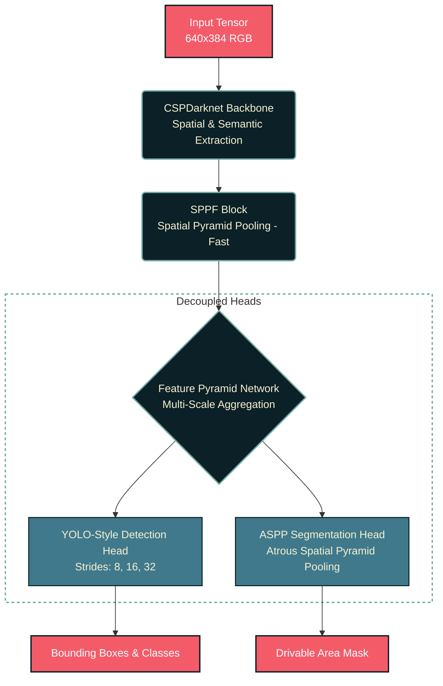

    
# Panoptic Perception

A high-performance, real-time perception Engine built from scratch in PyTorch for autonomous driving applications. By utilizing a shared CSPDarknet backbone, SPPF block, and decoupled task heads, the architecture simultaneously performs object detection and drivable area segmentation on the BDD100K dataset. The system is engineered strictly for edge deployment, prioritizing low latency and minimal VRAM consumption without relying on heavy, pre-packaged frameworks.

  <video src="
https://github.com/user-attachments/assets/ce63f7f4-e550-4422-990a-41fca6893cf9" autoplay loop muted playsinline width="100%"></video>

---

## System Overview
Standard multi-task models often deploy parallel networks that duplicate feature extraction, leading to massive memory overhead and latency spikes. This engine resolves that bottleneck by processing the spatial environment through a single optimized backbone before branching into specialized heads. 

To guarantee real-time throughput and memory efficiency on edge hardware (e.g., NVIDIA Jetson architectures), the system implements several low-level optimizations:

* **Mixed Precision Operations:** Native `bfloat16` precision across forward passes and loss calculations prevents NaN gradient overflow and accelerates training.
* **Vectorized Post-Processing:** Hand-written, vectorized implementations for YOLO bounding box decoding, NMS handling, and IoU matching eliminate Python loop bottlenecks.
* **In-Memory Caching:** Custom dataloader pipeline caches 10,000+ BDD100K labels directly into system RAM to eliminate storage I/O latency during epochs.

---

## Neural Architecture
The network utilizes a shared feature extraction pipeline that feeds into specialized, decoupled heads for distinct panoptic tasks.

### Core Components

1. **CSPDarknet Backbone:** Cross Stage Partial network that effectively extracts spatial gradients and semantic features while cutting computational overhead in half compared to standard residual networks.
2. **SPPF (Spatial Pyramid Pooling - Fast):** Maximizes the receptive field by pooling features at multiple scales, ensuring the network can detect large objects in the immediate foreground and small objects in the distance.
3. **Feature Pyramid Network (FPN):** Aggregates the multi-scale contextual features from the backbone to feed the task-specific heads.
4. **Decoupled Heads:**
* **Detection:** A YOLO-style head utilizing Custom Focal Loss and Non-Maximum Suppression (NMS) to output bounding boxes across three stride levels.
* **Segmentation:** An ASPP block that processes the aggregated features to decode and project a binary drivable area mask.

---

## Regularization & Training Dynamics
To prevent structural overfitting, the pipeline introduces advanced regularization protocols:

* **Albumentations Pipeline:** Integrated spatial and color transformations including **Mosaic**, **MixUp**, and **Color Jittering**. This forces the model to learn physical object geometry rather than memorizing absolute screen coordinates, completely eliminating spatial hallucinations (e.g., detecting pedestrians in the sky).
* **Early Stopping Mechanics:** Implemented dynamic validation loss tracking with a patience threshold. This automatically halts the training loop upon plateau, securing the optimal checkpoint and preventing the overfitting.

---

## Performance Benchmarks & Validation
Evaluated directly on the BDD100K validation split using an NVIDIA A100 GPU at `bfloat16` precision.

    
| Metric | Current Score |
| --- | --- |
| **Segmentation mIoU** | **81.88%** |
| **Segmentation Pixel Accuracy** | **97.11%** |
| **Detection F1/mAP** | **0.4283** |
| **Inference Latency** | **5.05 ms** | 
| **Throughput** | **198.21 FPS** | 
| **Peak VRAM Usage** | **2.37 GB** |

---

### Industry SOTA vs. Panoptic Engine Comparison

State-of-the-art (SOTA) object detection and segmentation frameworks often prioritize absolute mAP on leaderboards at the cost of operational deployment viability.

| Metric / Feature | Panoptic Engine (This Project) | Industry SOTA (e.g., YOLOv8x, Mask R-CNN) |
| --- | --- | --- |
| **Architecture** | Custom CSPDarknet + SPPF + FPN | Deep pre-trained transformers / Heavy CNNs |
| **Task Execution** | Simultaneous (Shared Backbone) | Often sequential or require multiple isolated models |
| **Peak Memory Overhead** | **~2.37 GB VRAM** | 8.0 GB to 16.0 GB VRAM |
| **Inference Latency** | **~5.05 ms** | 15.0 ms to 45.0+ ms |
| **Throughput** | **~200 FPS** | < 60 FPS (without TensorRT compilation) |
---
