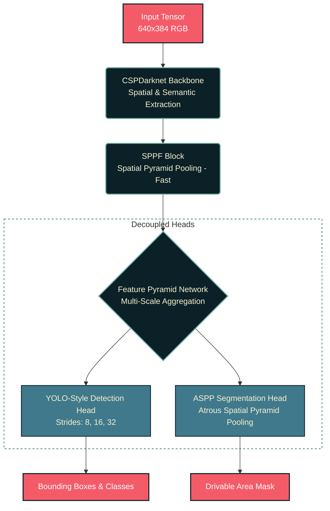

    
# Panoptic Perception

A high-performance, real-time perception Engine built from scratch in PyTorch for autonomous driving applications. By utilizing a shared CSPDarknet backbone, SPPF block, and decoupled task heads, the architecture simultaneously performs object detection and drivable area segmentation on the BDD100K dataset. The system is engineered strictly for edge deployment, prioritizing low latency and minimal VRAM consumption without relying on heavy, pre-packaged frameworks.

  <video src="https://github.com/user-attachments/assets/ce63f7f4-e550-4422-990a-41fca6893cf9" autoplay loop muted playsinline width="100%"></video>

> *Original dashcam footage credited to [Dashcam NYC](https://www.youtube.com/watch?v=KntRghSj_UQ). Processed for machine learning demonstration purposes.*

---

## System Overview
Standard multi-task models often deploy parallel networks that duplicate feature extraction, leading to massive memory overhead and latency spikes. This engine resolves that bottleneck by processing the spatial environment through a single optimized backbone before branching into specialized heads. 

To guarantee real-time throughput and memory efficiency on edge hardware (e.g., NVIDIA Jetson architectures), the system implements several low-level optimizations:

- **Mixed Precision Operations:** Native `bfloat16` precision across forward passes and loss calculations prevents NaN gradient overflow and accelerates training.
- **Vectorized Post-Processing:** Hand-written, vectorized implementations for YOLO bounding box decoding, NMS handling, and IoU matching eliminate Python loop bottlenecks.
- **In-Memory Caching:** Custom dataloader pipeline caches 10,000+ BDD100K labels directly into system RAM to eliminate storage I/O latency during epochs.

---

## Neural Architecture
The network utilizes a shared feature extraction pipeline that feeds into specialized, decoupled heads for distinct panoptic tasks.

### Core Components

1. **CSPDarknet Backbone:** Cross Stage Partial network that effectively extracts spatial gradients and semantic features while cutting computational overhead in half compared to standard residual networks.
2. **SPPF (Spatial Pyramid Pooling - Fast):** Maximizes the receptive field by pooling features at multiple scales, ensuring the network can detect large objects in the immediate foreground and small objects in the distance.
3. **Feature Pyramid Network (FPN):** Aggregates the multi-scale contextual features from the backbone to feed the task-specific heads.
4. **Decoupled Heads:**

* **Detection:** A YOLO-style head utilizing Custom Focal Loss and Non-Maximum Suppression (NMS) to output bounding boxes across three stride levels.
* **Segmentation:** An ASPP block that processes the aggregated features to decode and project a binary drivable area mask.

---

## Regularization & Training Dynamics

To prevent structural overfitting, the pipeline introduces advanced regularization protocols:

* **Two-Phase Curriculum Learning:** The model is first converged on standard data, followed by a second phase injecting spatial/color transforms (Mosaic, MixUp, Albumentations) to break reliance on absolute coordinate positioning.
* **Spatial Hallucination Mitigation:** By forcing the model to learn physical object geometry rather than memorizing screen locations, the curriculum phase significantly improves generalization and eliminates false positives.
* **Early Stopping Mechanics:** Implemented dynamic validation loss tracking with a patience threshold. This automatically halts the training loop upon plateau, securing the optimal checkpoint and preventing overfitting.

---

## Performance Benchmarks & Validation

Evaluated directly on the BDD100K validation split using an NVIDIA A100 GPU at `bfloat16` precision.

| Metric | Current Score |
| --- | --- |
| **Segmentation mIoU** | **82.16%** |
| **Segmentation Pixel Accuracy** | **97.18%** |
| **Detection F1/mAP** | **0.4283** |
| **Inference Latency** | **4.92 ms per frame** |
| **Throughput** | **203.06 FPS** |
| **Peak VRAM Usage** | **1.46 GB** |

<table>
  <tr>
    <td align="center">
      
       <b>Baseline Latency Distribution</b>
    </td>
    <td align="center">
      
       <b>Augmented Latency Distribution</b>
    </td>
  </tr>
  <tr>
    <td align="center">
      
    </td>
    <td align="center">
      
    </td>
  </tr>
</table>
---

## Industry SOTA vs. Panoptic Engine Comparison

In autonomous vehicle perception, the goal is maximizing accuracy within a strict computational budget (SWaP: Size, Weight, and Power). While heavyweight state-of-the-art (SOTA) frameworks often prioritize absolute leaderboard mAP, they typically suffer from massive memory overhead and single-digit FPS, rendering them unviable for production edge hardware (e.g., NVIDIA Jetson Nano/Orin).

This engine is engineered to hit the **Pareto frontier** of speed, memory, and accuracy. It trades a marginal ~2-4% in absolute accuracy to achieve a **400% to 500% speed multiplier** over standard edge solutions, while consuming a fraction of the VRAM.

| Architecture / Model | Segmentation mIoU | Detection mAP/F1 | Inference Speed (FPS) | Peak VRAM |
| --- | --- | --- | --- | --- | 
| **Mask R-CNN** (Heavyweight) | ~83% - 85% | 45% - 48% | 5 - 10 FPS | 8.0 GB+ | 
| **YOLOP** (Industry Standard Edge) | ~84% | ~44% | ~40 - 50 FPS | ~3.0 GB | 
| **HybridNets** (E2E SOTA) | ~85% | ~46% | ~30 - 35 FPS | ~4.0 GB |
| **Panoptic Engine (This Project)** | **82.16%** | **42.83%** | **203 FPS** | **1.46 GB** | 

*(Note: FPS metrics for external baselines are normalized to modern server GPUs to match the testing environment of this project.)*

---
